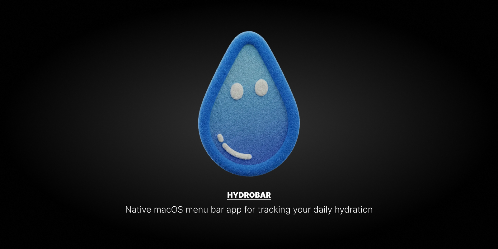
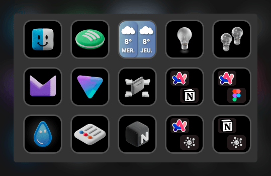
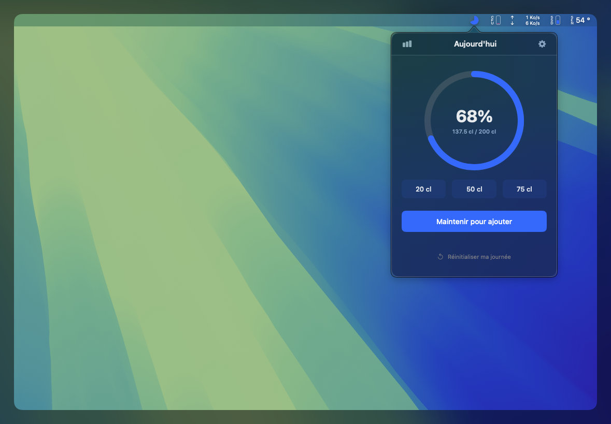
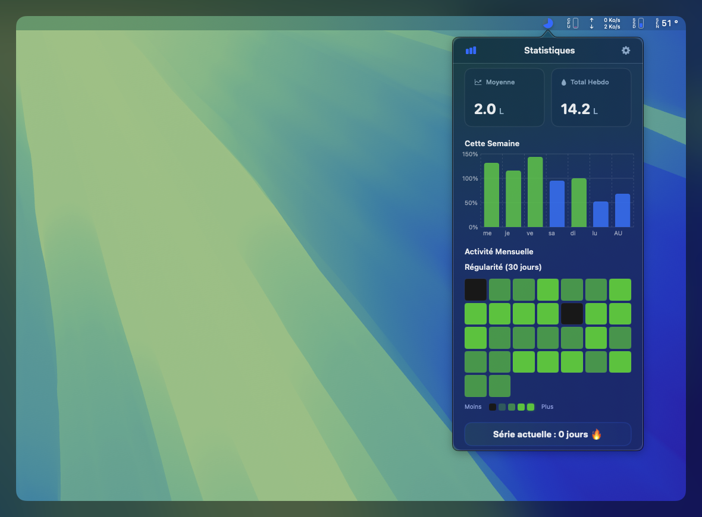
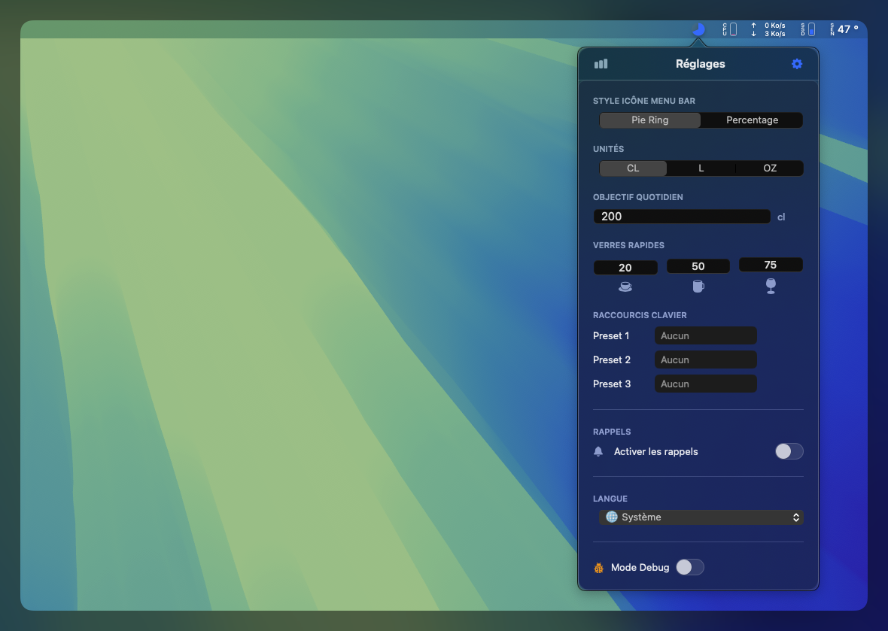
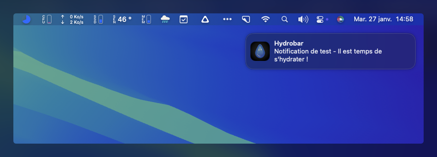

<div align="center">

# 💧 HYDROBAR

[](https://github.com/aedhx/HydroBar/actions/workflows/ci.yml)


**Native macOS menu bar app for tracking your daily hydration**

[Features](#-features) • [Installation](#-installation) • [Raycast](#raycast-extension) • [Usage](#-usage) • [Building](#-building-from-source)



</div>

---

## ✨ About

HydroBar is a native macOS application that helps you stay hydrated throughout the day. Running discreetly in your menu bar, it tracks your water intake, sends reminders, and provides detailed statistics to help you maintain healthy hydration habits.

Built with SwiftUI and following Apple's Human Interface Guidelines, HydroBar offers a smooth, intuitive experience that feels native to macOS.

---

## 🎯 Features

### 💧 Daily Hydration Tracking
- **Real-time progress ring** with animated visual feedback and gradient colors
- **Customizable daily goal** (ml, cl, L, US fl oz, UK fl oz), with an optional goal for each day of the week
- **Bottle mode**: log a quarter, half, three quarters or a finished bottle
- **Quick preset buttons** for common water amounts
- **Hold-to-Add mode** for continuous water intake with haptic feedback, showing the running total on the button
- **Today's log**: see every drink logged today with its time, remove any single entry (⌘Z brings it back), or add a drink you forgot to log earlier
- **Automatic daily reset** at midnight, and **Reset my day** can be undone

### 📊 Advanced Statistics
- **Weekly bar chart** showing your progress over the last 7 days
- **30-day heatmap** visualizing your consistency (hover any day to see date and amount, like GitHub’s contribution graph)
- **Key metrics**: daily average, weekly total, current streak
- **When you drink**: average intake by hour over 30 days, and your longest dry spell
- **This month**: a recap card you can share or copy as an image
- **Your year**: daily average for each of the last 12 months
- **Color-coded indicators** (green for goal achieved, blue for in progress)

### 🔔 Smart Notifications
- **Reminder intervals**: every 30 minutes, every 2 hours, or a custom interval (5 to 480 minutes)
- **Smart scheduling**: reminders stay within your active hours, stop once your goal is reached, come a bit more often when you're behind your pace, and pause while your screen is asleep
- **Goal celebration**: one notification when you cross your daily goal, with your streak
- **Weekly summary** on the last evening of the week
- **Focus filter**: set any macOS Focus to turn reminders into a menu bar badge
- **Pause reminders** for 1 hour, until this evening or until tomorrow, from the notification, the menu bar icon or Settings; the pause ends by itself
- **Focus Mode integration**: reminders turn into a menu bar badge while a macOS Focus is on
- **Visual badge** in menu bar when reminders are active
- **Actionable notifications**: your presets as buttons, an *Other Amount…* field to type any amount, and Snooze; in bottle mode, the bottle levels
- **Informative text**: where you are, what's left before the end of your day, or how far behind your pace
- **Last call** one hour before your day ends if the goal isn't reached
- **Hold during calls**: no reminder while an app uses your microphone or camera

### 🗓️ Work Days and Days Off
- Days off get their own active hours, reminder cadence (or none) and goal
- Weekends by default; pick your own days
- **Today Is a Day Off** from the menu bar icon or the popover, for a holiday or a sick day
- **Time off**: a start and end date, every day in between is a day off
- Automatic with a Focus: add the HydroBar filter to your Work Focus and set its day type

### ⌨️ Global Keyboard Shortcuts
- **Custom shortcuts** for each preset amount, plus **Undo** and **Open HydroBar**
- **System-wide functionality**: works from any application
- **Intuitive recorder interface**, which tells you when a shortcut is already taken
- **Stream Deck compatible**: Use your configured shortcuts with Elgato Stream Deck for one-click hydration tracking

<div align="center">



*Configure your Stream Deck buttons to trigger HydroBar shortcuts for instant water intake logging with a single press.*

</div>

### ⏱️ Pace Marker

The ring shows a tick at where you *should* be at this time of day, based on your
active hours (8 AM – 10 PM by default, adjustable in Settings). 15 % at 9 AM is on
track, not a failure — the marker says so instead of leaving you to guess.

### 🎨 Modern Interface
- **Clean, minimal design** following macOS design principles
- **Adaptive dark/light mode** matching system preferences
- **Smooth animations** and transitions
- **Customizable menu bar icon**: choose between progress ring or percentage display

### 🌍 Multi-language Support
- **9 languages available**:
  - 🇬🇧 English
  - 🇫🇷 French
  - 🇪🇸 Spanish
  - 🇩🇪 German
  - 🇮🇹 Italian
  - 🇵🇹 Portuguese
  - 🇳🇱 Dutch
  - 🇯🇵 Japanese
  - 🇨🇳 Simplified Chinese
- **Automatic language detection** based on system settings
- **Manual language selection** available in settings

### 🔗 Deep Links & Automation

HydroBar registers the `hydrobar://` URL scheme, so any tool that can open a URL can
log water — Raycast, Alfred, Shortcuts, Stream Deck, Keyboard Maestro, Automator, or a
plain `open` in Terminal:

```bash
open "hydrobar://add?ml=250"       # add 250 ml (also ?cl= ?l= ?oz=)
open "hydrobar://add?preset=1"     # add your first configured preset
open "hydrobar://undo"             # undo the last entry
open "hydrobar://open/stats"       # open the popover on Statistics
```

Destructive actions (`reset`, `set-goal`) require an explicit `confirm=1` **and** a
confirmation in the app, because any web page can open a URL scheme. Amounts are
validated and rejected if out of range, and calls are rate limited.

Full grammar, security model, error codes and `x-callback-url` support:
[docs/specs/DEEP_LINKS.md](docs/specs/DEEP_LINKS.md).

### 🧩 Shortcuts, Spotlight and Siri

HydroBar adds six actions to the Shortcuts app: **Log Water**, **Log a Preset**,
**Get Hydration Status**, **Undo Last Drink**, **Set Daily Goal** and
**Set Today's Day Type**. Unlike deep
links, they return values (today's total, in milliliters), so you can build
automations around them.

### 💾 Export and Backup

In **Settings › Data**:
- **Export as CSV**: one line per day (`date,amount_ml,target_ml,goal_reached`), readable by any spreadsheet app
- **Back Up (JSON)**: every drink, with its time
- **Restore from Backup**: adds only the entries you don't already have, so restoring the same backup twice changes nothing

### 🔄 Additional Features
- **Check for updates** in Settings: compares with [GitHub Releases](https://github.com/aedhx/HydroBar/releases) and notifies when a new version is available
- **Undo/Redo support** (Cmd+Z) to correct mistakes
- **Complete history** saved locally on your Mac, one entry per drink, never cut off
- **Data persistence** across app restarts and updates
- **Privacy-first**: all data stays on your device, no cloud sync (only optional outbound request to GitHub API for update check)

---

## 🚀 Installation

### Method 1: Direct Download (Recommended)

1. Download `HydroBar-v1.2.dmg` from the [Releases](https://github.com/aedhx/HydroBar/releases) page
2. Mount the DMG and drag `HydroBar.app` into your Applications folder
3. **First launch** — macOS may block the app because it is not notarized. Use one of the methods below.

**If macOS says "app is damaged" or "cannot be opened":**

> **Method 1 — Terminal (most reliable):**
> ```bash
> xattr -cr /Applications/HydroBar.app
> ```
> Then double-click the app normally.

> **Method 2 — System Settings:**
> Open the app once (it will be blocked), then go to **System Settings → Privacy & Security** → click **Open Anyway**.

> **Method 3 — Right-click:**
> Right-click `HydroBar.app` → **Open** → **Open** in the dialog.

### Required Permissions

HydroBar asks for **notification** permission when you turn reminders on. If you
declined it, enable it again in System Settings › Notifications › HydroBar.

Global keyboard shortcuts need no special permission.

**Hold during calls** needs no permission either: HydroBar only checks whether an
app is using the microphone or camera, never what they capture.

### Method 2: Build from Source

```bash
# Clone the repository
git clone https://github.com/aedhx/HydroBar.git
cd HydroBar/src/HydroBar

# Open in Xcode
open HydroBar.xcodeproj

# Build and run (Cmd+R in Xcode)
```

**Requirements:**
- macOS 15.1 (Sequoia) or later
- Xcode 14.0 or later
- Swift 5.0+

---

## Raycast Extension

Control HydroBar from [Raycast](https://www.raycast.com/) with quick commands: log a preset or a custom amount, undo, or jump to your statistics — without leaving your keyboard.

**Requirements:** Raycast, and HydroBar 1.3 or later (earlier versions do not register the `hydrobar://` scheme). HydroBar does not need to be running: macOS launches it on demand.

| Command | Description |
|--------|-------------|
| **Add Water – Preset 1** | Log your first preset |
| **Add Water – Preset 2** | Log your second preset |
| **Add Water – Preset 3** | Log your third preset |
| **Add Water (Custom)** | Log a custom amount in ml, between 1 and 5000 |
| **Undo Last Water** | Remove the last entry |
| **Open HydroBar Statistics** | Open HydroBar on the statistics view |

The preset commands follow whatever amounts you configure in HydroBar — change a preset in Settings and the Raycast command follows it.


**Install:**

1. Download `hydrobar-raycast-extension.zip` from the [Releases](https://github.com/aedhx/HydroBar/releases) page (or clone the repo and run `./package-raycast-extension.sh` to create the zip).
2. Unzip, then in a terminal: `cd raycast-hydrobar && npm install`.
3. In Raycast: **Settings → Extensions → Add Extension → Add from folder** → select the `raycast-hydrobar` folder.
4. Run `npm run dev` in the `raycast-hydrobar` folder so the commands appear in Raycast (you can leave this running in the background).

Then search for **HydroBar** or **Add Water** in Raycast to use the commands. See [raycast-hydrobar/README.md](raycast-hydrobar/README.md) for details and troubleshooting.

---

## 📸 Screenshots

### Main View
The main interface displays your daily hydration progress with an animated circular progress ring showing your current percentage (68% in this example), quick preset buttons (20cl, 50cl, 75cl), and a Hold-to-Add feature for continuous water intake. The interface shows your current intake (137.5 cl) versus your daily goal (200 cl).



### Statistics
View your hydration data with a weekly bar chart showing your progress over 7 days, and a 30-day heatmap visualizing your consistency. Key metrics include daily average (2.0 L) and weekly totals (14.2 L). The chart uses color coding: green bars indicate goal achievement, blue bars show progress.



### Settings
Customize your experience: set daily goals, choose units (ml, cl, L, oz), configure menu bar icon style (Pie Ring or Percentage), set up notifications, assign keyboard shortcuts, **check for updates** (compares with GitHub Releases), and select your preferred language. The settings interface is clean and organized, making it easy to personalize your hydration tracking.



### Notifications
Smart reminders with customizable intervals. Notifications integrate seamlessly with macOS and respect your Focus Mode settings. The notification displays the app icon and a friendly reminder message to stay hydrated.



---

## 📖 Usage

### Getting Started

On first launch, a short welcome sets up your unit, daily goal (with an optional
suggestion from your weight), presets and reminders. Everything can be changed
later in Settings.

1. **Add water**: Click preset buttons or use the Hold-to-Add feature
2. **Check today's log**: Expand it under the Hold-to-Add button to review or remove entries
3. **Enable reminders**: Configure notification intervals in Settings
4. **Set shortcuts** (optional): Record global keyboard shortcuts for quick water intake

### Menu Bar Icon

- **Click** the icon to open the main popover
- **⌘,** or **Settings…** in the context menu opens the Settings window
- **Option-click** to log your first preset without opening it
- **Right-click** for the context menu:
  - **Version** at the top (current app version)
  - **Add** one of your presets, and **Undo**
  - **Pause Reminders** (or **Resume Reminders** while paused)
  - **Keyboard Shortcuts** submenu: view your configured shortcuts
  - **About** (version and credits)
  - **View Repository** (open GitHub sources)
  - **Quit**
- **Icon styles**: Progress ring (default) or percentage display, monochrome to match your menu bar (a colored icon is available in Settings)
- **Badge indicator**: Red dot appears when reminders are active

### Statistics View

Access detailed statistics by clicking the chart icon in the main view:
- **Weekly chart**: Bar graph showing daily progress
- **Monthly heatmap**: Color-coded grid showing 30-day consistency; **hover any day** to see a tooltip with the date and hydration amount (or “No activity”)
- **Key metrics**: Average daily intake and weekly totals

---

## 🛠️ Building from Source

### Prerequisites

- macOS 15.1+ (Sequoia or later)
- Xcode 14.0+
- Command Line Tools

### Build Steps

1. Clone the repository:
   ```bash
   git clone https://github.com/aedhx/HydroBar.git
   cd HydroBar/src/HydroBar
   ```

2. Open the project in Xcode:
   ```bash
   open HydroBar.xcodeproj
   ```

3. Select the `HydroBar` scheme and build (Cmd+B) or run (Cmd+R)

### Repository Structure

The repository contains only the essential files:

```
HydroBar/
├── src/
│   └── HydroBar/
│       ├── HydroBar/                    # Main app source
│       │   ├── *.swift                  # Swift source files
│       │   ├── Assets.xcassets/         # App icons and assets
│       │   └── Localizable.xcstrings    # Localization (9 languages)
│       ├── HydroBarWidget/              # Widget extension
│       │   ├── HydroBarWidget.swift     # Widget views (Small + Medium)
│       │   └── AppGroupStore.swift      # Shared data bridge (App Group)
│       ├── HydroBar.xcodeproj/          # Xcode project
│       └── HydroBarTests/               # Unit tests
├── Resources/                            # Assets for distribution
│   ├── HydroBar-icon.png                # Application icon
│   └── DMG-background.png               # DMG background image
├── build-dmg.sh                          # DMG packaging script
└── README.md                             # This file
```

**Note:** Build scripts and additional documentation have been removed to keep the repository minimal and focused on the source code.

---

## 🏗️ Architecture

HydroBar follows the **MVVM (Model-View-ViewModel)** pattern:

- **Model**: `HydrationManager` - Core data logic and state management
- **View**: SwiftUI views (`MainView`, `SettingsView`, `StatisticsView`)
- **ViewModel**: `HydrationManager` as `ObservableObject` binding views to data

### Key Components

- `HydrationManager.swift`: Core business logic, reminders, App Group sync
- `IntakeLog.swift` / `IntakeLogStore.swift`: The intake log (one event per drink) and its storage
- `HydroBarIntents.swift`: Shortcuts, Spotlight and Siri actions
- `DataPortability.swift`: CSV export, JSON backup and restore
- `OnboardingView.swift`: First-launch welcome
- `HydroBarApp.swift`: App lifecycle, menu bar setup, context menu, notifications
- `MainView.swift`: Main interface with progress ring and quick actions
- `SettingsView.swift`: Configuration, preferences, and update check (UPDATES section)
- `StatisticsView.swift`: Weekly and monthly statistics visualization
- `StatsComponents.swift`: Heatmap with hover tooltips, KPI cards, weekly chart
- `GitHubUpdateChecker.swift`: Check for new releases via GitHub API
- `GlobalHotkeyManager.swift`: System-wide keyboard shortcut handling
- `FocusModeMonitor.swift`: macOS Focus Mode integration
- `HydroBarWidget/HydroBarWidget.swift`: Widget views (Small + Medium families)
- `HydroBarWidget/AppGroupStore.swift`: Shared data bridge between app and widget
- `Localizable.xcstrings`: Multi-language support (9 languages)

### Technical Documentation

In-depth engineering docs live in [`docs/`](docs/README.md):

- [**Technical audit**](docs/AUDIT_TECHNIQUE.md) — code review, findings ranked P0→P4 and their fixes
- [**Feature roadmap**](docs/ROADMAP_FONCTIONNALITES.md) — 21 proposals ranked by value/effort, with what shipped in v2.0
- [**Deep links spec**](docs/specs/DEEP_LINKS.md) — the `hydrobar://` URL scheme: grammar, security model, callbacks, tests

> These documents are written in French.

---

## 🔒 Privacy & Security

- ✅ **100% local storage**: All data stays on your Mac
- ✅ **Optional network use**: Only for “Check for updates” in Settings (GitHub API, no tracking)
- ✅ **No tracking or analytics**
- ✅ **Open source**: Code is publicly available for review
- ✅ **No data collection**: We don't collect any personal information

### Gatekeeper Notice

> **Going away soon.** The build script now supports Developer ID signing and
> notarization; once a signed release ships, this whole section disappears and
> HydroBar opens on a double-click.

Current releases are signed ad-hoc, so macOS may show a "damaged" or "cannot be opened" warning. This is expected — run the following command in Terminal to remove the quarantine flag, then open normally:

```bash
xattr -cr /Applications/HydroBar.app
```

---

## 🐛 Troubleshooting

### App won't open
- Right-click the app > Open (first launch only)
- Check System Preferences > Security & Privacy > General for "Open Anyway" option

### Notifications not working
- Enable notifications in System Preferences > Notifications
- Check that Do Not Disturb mode is not enabled
- Verify notification settings in HydroBar Settings

### Keyboard shortcuts not working
- Check Settings › Keyboard Shortcuts: a shortcut that another app already uses is marked as inactive
- Choose a different combination for it

### Icon not visible in menu bar
- Check that the app is running (Activity Monitor)
- On Retina displays, the icon may appear very small
- Try restarting the app

---

## 📝 Requirements

- **macOS**: 15.1 (Sequoia) or later
- **Architecture**: Universal (Intel and Apple Silicon)
- **Disk space**: ~15-20 MB
- **Permissions**: Notifications (only if you turn reminders on)

---

## 🛣️ Roadmap

Future improvements planned:
- [x] Deep links / URL scheme *(v1.3)*
- [x] Launch at login *(v1.3)*
- [x] Pace marker on the progress ring *(v1.3)*
- [x] Desktop widgets (small and medium), in sync with the app *(v1.3)*
- [x] Custom preset amounts
- [x] Today's log, data export and backup *(v2.0)*
- [x] Shortcuts app actions, smart reminders and snooze, welcome screen *(v2.0)*
- [x] Hourly pattern, logging earlier drinks, accessibility *(v2.0)*
- [x] Monochrome menu bar icon, micro-animations, tabbed Settings window *(v2.0)*
- [x] Bottle mode, goals by day of the week, suggested presets, Focus filter, weekly summary *(v2.0)*
- [x] Year chart, shareable monthly recap, Control Center button *(v2.0)*
- [ ] iCloud sync (optional)
- [ ] Advanced statistics filters

HydroBar is a **macOS-only** app, and an iOS version is not planned for now.
Apple Health integration is not on the roadmap either: HealthKit is not available
to native macOS apps. See [`docs/ROADMAP_FONCTIONNALITES.md`](docs/ROADMAP_FONCTIONNALITES.md)
for the detailed roadmap.

---

## 📄 License

This project is licensed under the MIT License - see the LICENSE file for details.

---

## 👨‍💻 Developer

**Antoine Deshoux**
- 🌐 Website: [https://adx.cool/](https://adx.cool/)
- 💼 LinkedIn: [https://www.linkedin.com/in/deshouxantoine/](https://www.linkedin.com/in/deshouxantoine/)

---

## 🤝 Contributing

Contributions are welcome! Please feel free to submit a Pull Request. For major changes, please open an issue first to discuss what you would like to change.

1. Fork the repository
2. Create your feature branch (`git checkout -b feature/AmazingFeature`)
3. Commit your changes (`git commit -m 'Add some AmazingFeature'`)
4. Push to the branch (`git push origin feature/AmazingFeature`)
5. Open a Pull Request

---

## 📬 Support

- 🐛 **Bug reports**: [Open an issue](https://github.com/aedhx/HydroBar/issues)
- 💡 **Feature requests**: [Open an issue](https://github.com/aedhx/HydroBar/issues)
- ❓ **Questions**: Check existing issues or open a new one

---

<div align="center">

Made with ❤️ for macOS users

</div>
