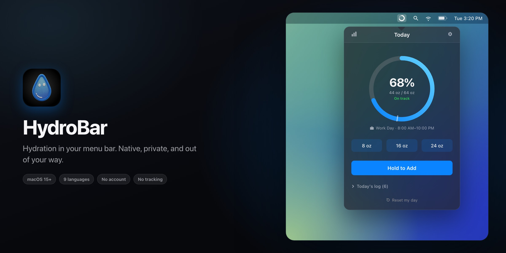
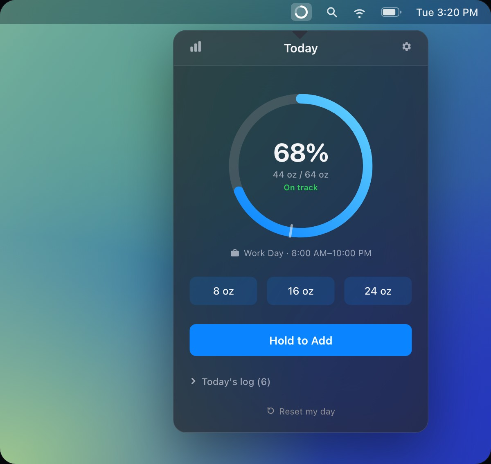
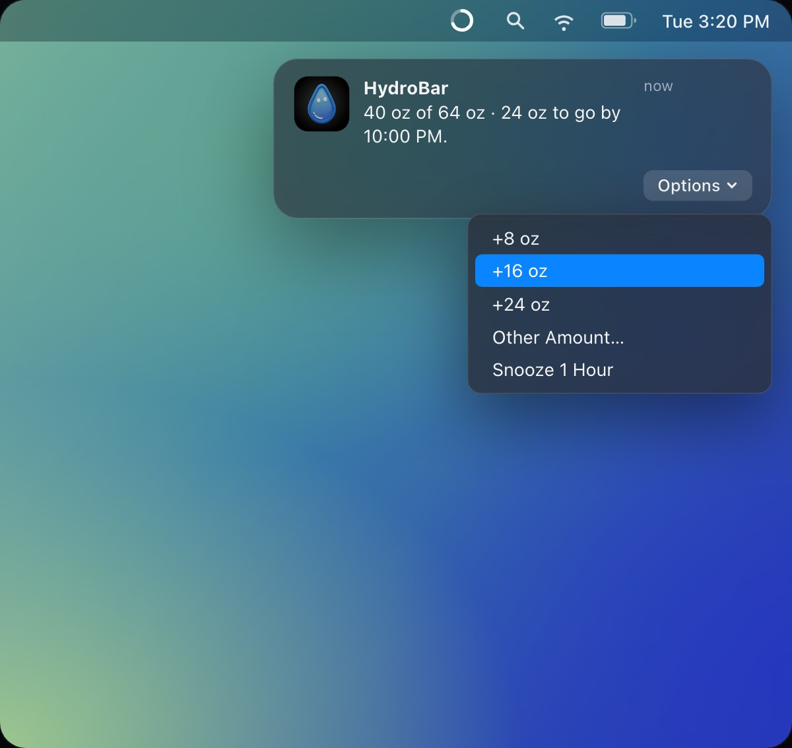
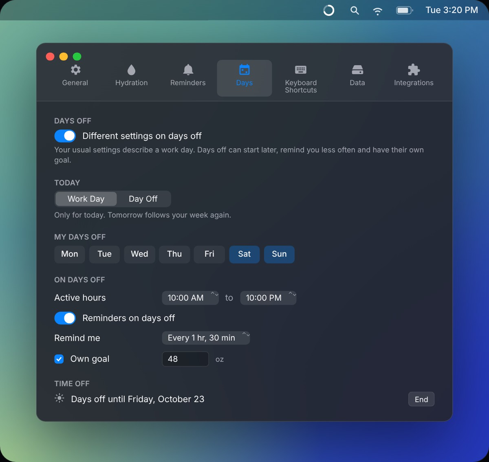
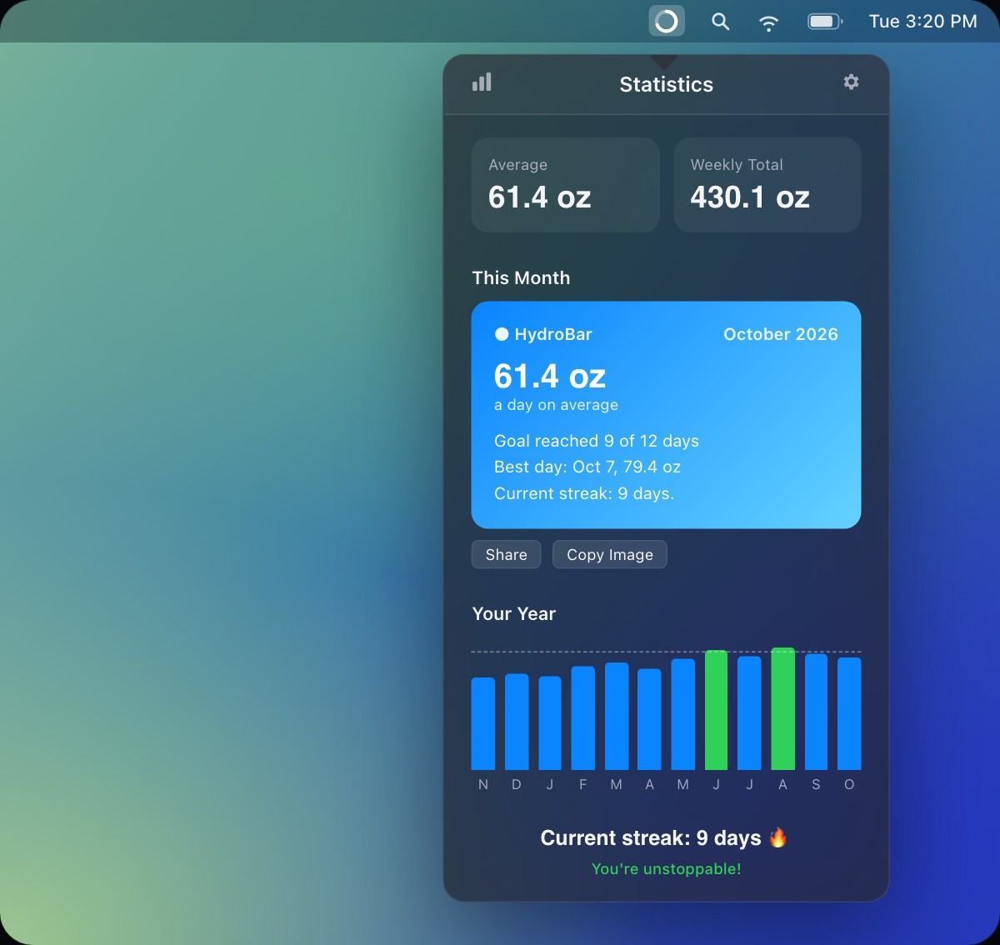
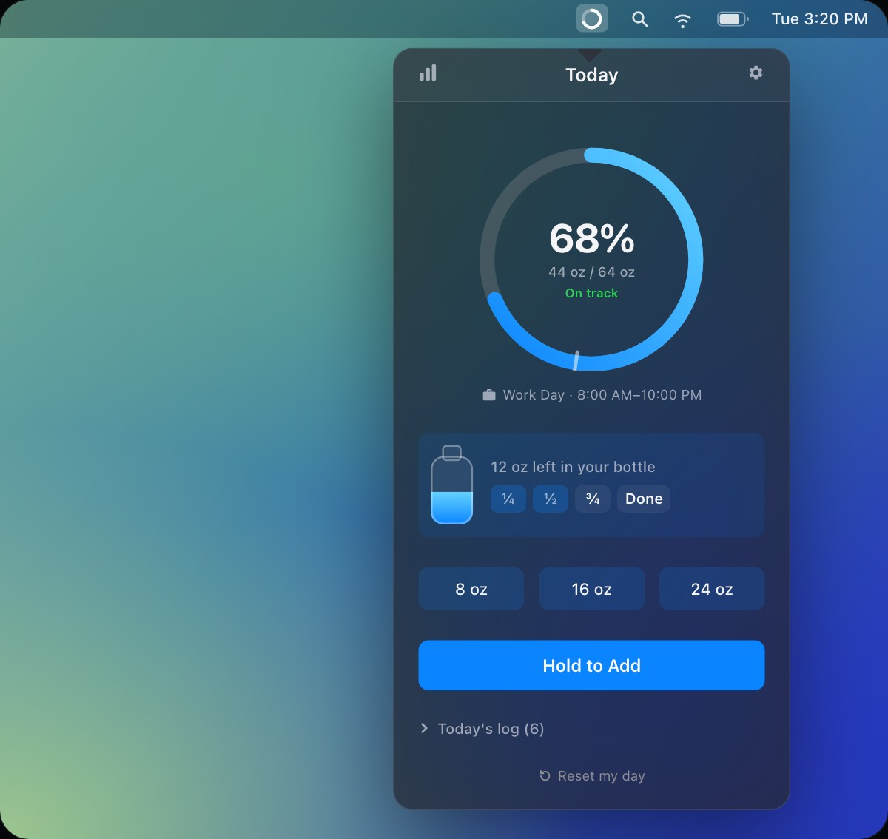
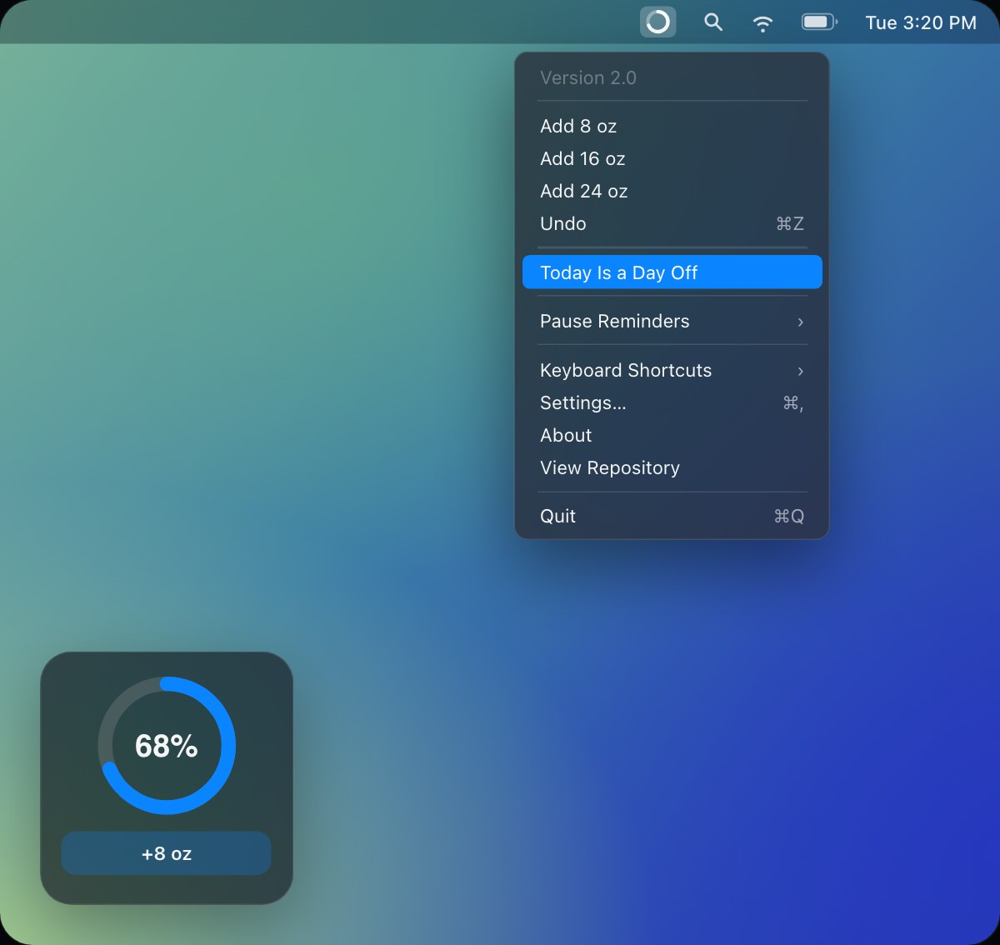

<div align="center">



[](https://github.com/aedhx/HydroBar/actions/workflows/ci.yml)


**Drink enough water, without thinking about it.**
HydroBar lives in your menu bar: one click to log a glass, a ring that shows where you are,
and reminders that respect your day. No account, no tracking: everything stays on your Mac.

[Install](#install) · [What's new in 2.0](#whats-new-in-20) · [Features](#features) · [Automation](#automation) · [Privacy](#privacy) · [Build from source](#build-from-source)

</div>

---

## What's new in 2.0

HydroBar 2.0 is the biggest update since the first release, and the first on the Mac App Store.

- **Reminders you can act on**: they say where you are, offer your presets as buttons, and take any amount you type.
- **Work days and days off**, each with its own hours, reminders and goal.
- **No reminders during calls**, and a **last call** before your day ends.
- **Bottle mode**, **presets that learn** and a **goal for each day of the week**.
- **Today's log**, **monthly recap** to share, **your year** at a glance, **when you drink** during the day.
- **Shortcuts, Siri, Spotlight**, a **Control Center** button and a desktop widget that stays in sync.
- A new **monochrome menu bar icon**, livelier animations and a real **Settings window**.
- **Your data is safer**: one entry per drink, an unlimited history, CSV export and JSON backup. Two bugs that could erase your history are fixed.

Full details in the [release notes](RELEASE_NOTES_v2.0.md).

---

## Features

### Log in a second



- **Your own presets**, one click each, in ml, cl, L, US or UK fl oz.
- **Hold to Add** for any amount, with the running total on the button.
- **The ring** fills with your progress. A tick marks where you should be by now, so 15 % at 9 AM reads as *on track*, not as a failure.
- **Today's log**: every drink with its time. Remove one, and ⌘Z brings it back. Forgot a glass yesterday? Add an earlier drink.
- **Option-click** the menu bar icon to log your first preset without opening anything.

<br clear="right">

### Reminders you can act on



- They tell you where you are: *"40 oz of 64 oz · 24 oz to go by 10:00 PM"*. When you're behind, they say where you'd ideally be.
- Log a preset, or **type any amount**, right from the notification.
- Only during your **active hours**, and they stop once your goal is reached.
- A bit more often when you're **behind your pace**, never more than every 15 minutes.
- They **wait while you're on a call** or in a video meeting, and while your screen is asleep.
- A **last call** comes an hour before your day ends, and a single notification celebrates your goal.
- **Pause** them for an hour, until this evening or until tomorrow.

<br clear="right">

### Work days. Days off.



- Days off get their own **active hours**, **reminder cadence** (or none at all) and **goal**.
- Weekends by default, or pick your own days.
- **Today Is a Day Off** from the menu bar icon, for a holiday or a sick day.
- **Time off**: two dates, and every day in between is a day off.
- **Automatic**: add the HydroBar filter to your Work Focus, and the Focus decides.

<br clear="right">

### See your progress



- Daily average, weekly total and your **streak**.
- A **monthly recap card** to share or copy as an image.
- **Your year**: your daily average for each of the last 12 months.
- **When you drink** during the day, and your longest dry spell.
- A **30-day heatmap** and a weekly chart.
- A different **goal for each day of the week**.

<br clear="right">

### Bottle mode



Drinking from a bottle at your desk? Say how much of it is gone, a quarter, half, three quarters or done, and HydroBar logs the difference. The bottle empties on screen, and Undo puts the water back.

<br clear="right">

### Everywhere on your Mac



- A **desktop widget**, in sync with the app.
- An **Add Water** button for Control Center and the menu bar (macOS 26).
- **Global keyboard shortcuts** for each preset, Undo and Open HydroBar. They work with a Stream Deck too.
- A **context menu** on the icon: presets, Undo, day off, pause, Settings.
- A **monochrome icon** that matches your menu bar, with a checkmark when you reach your goal.
- **9 languages**: English, French, German, Spanish, Italian, Japanese, Dutch, Portuguese and Simplified Chinese.
- **Accessible**: VoiceOver describes your progress, every animation respects *Reduce motion*, and reaching the goal shows a checkmark, not just a color.

<br clear="right">

---

## Automation

### Shortcuts, Siri and Spotlight

Six actions for the Shortcuts app: **Log Water**, **Log a Preset**, **Get Hydration Status**, **Undo Last Drink**, **Set Daily Goal** and **Set Today's Day Type**. They return values, so you can build on them: log a glass every morning, or switch to a day off when you connect to your home Wi-Fi.

### Focus

In **System Settings › Focus**, add the HydroBar filter to any Focus. It can turn reminders into a discreet menu bar badge, and choose the day type: work day or day off.

### Deep links

HydroBar registers the `hydrobar://` URL scheme, so anything that can open a URL can log water: Raycast, Alfred, Stream Deck, Keyboard Maestro, or `open` in Terminal.

```bash
open "hydrobar://add?ml=250"       # add 250 ml (also ?cl= ?l= ?oz=)
open "hydrobar://add?preset=1"     # add your first preset
open "hydrobar://undo"             # undo the last entry
open "hydrobar://open/stats"       # open the popover on Statistics
```

Destructive actions (`reset`, `set-goal`) need `confirm=1` **and** a confirmation in the app, because any web page can open a URL scheme. Amounts are validated and calls are rate limited. Full grammar, security model and `x-callback-url` support: [docs/specs/DEEP_LINKS.md](docs/specs/DEEP_LINKS.md).

### Raycast

The [Raycast extension](raycast-hydrobar/README.md) logs a preset or any amount, undoes, and opens your statistics without leaving the keyboard. Download `hydrobar-raycast-extension.zip` from the [Releases](https://github.com/aedhx/HydroBar/releases) page, or run `./package-raycast-extension.sh`, then add the folder in Raycast › Settings › Extensions.

---

## Privacy

- **No data collected.** No account, no analytics, no advertising, no tracking.
- **Everything stays on your Mac**, in HydroBar's sandbox. The Mac App Store version has no network access at all. The direct download only contacts GitHub when you check for updates.
- **Your weight**, if you use it for a goal suggestion, is never saved.
- **Hold during calls** only checks whether an app is using the microphone or camera. HydroBar never turns them on and receives nothing.
- **Your data is yours**: export to CSV, back up to JSON, restore at any time.

Read the [privacy policy](PRIVACY.md).

---

## Install

### Mac App Store

<!-- Replace with the App Store link once the app is live: https://apps.apple.com/app/idXXXXXXXXXX -->
Search for **HydroBar** in the Mac App Store. Updates come through the App Store.

### Direct download

1. Download `HydroBar-v2.0.dmg` from the [Releases](https://github.com/aedhx/HydroBar/releases) page.
2. Open it and drag **HydroBar** into Applications.
3. If macOS says the app "is damaged" or "cannot be opened", the build is not notarized. Run this once, then open it normally:

   ```bash
   xattr -cr /Applications/HydroBar.app
   ```

The direct download checks for updates on GitHub from **Settings › General**.

### Permissions

HydroBar asks for **notification** permission only when you turn reminders on. Nothing else needs a permission: not the keyboard shortcuts, not the Focus filter, not the call detection.

### Requirements

macOS 15.1 (Sequoia) or later, on Apple Silicon or Intel.

---

## Build from source

```bash
git clone https://github.com/aedhx/HydroBar.git
open HydroBar/src/HydroBar/HydroBar.xcodeproj   # then ⌘R
```

You need Xcode 16 or later. The CI builds both variants and runs the unit tests on every push.

| Script | What it does |
|---|---|
| `./build-dmg.sh` | Release build, packaged as a DMG and a ZIP, optionally signed and notarized |
| `./build-appstore.sh` | Mac App Store build (no update check, no network), archived and uploaded |
| `node marketing/render.cjs` | App Store screenshots in 9 languages, and the images of this README (`--readme`) |
| `python3 fastlane/check_metadata.py` | Checks the App Store listing in every language |

### Repository

```
src/HydroBar/
├── HydroBar/          the app: SwiftUI views, HydrationManager, intake log, reminders
├── HydroBarWidget/    desktop widget and Control Center button
└── HydroBarTests/     unit tests (Swift Testing)
fastlane/              App Store listing in 9 languages, and its screenshots
marketing/             screenshot and README image generator
raycast-hydrobar/      Raycast extension
docs/                  technical audit, roadmap, deep link spec, App Store guide
```

Main pieces of the app:

- `IntakeLog` / `IntakeLogStore`: the source of truth, one event per drink.
- `HydrationManager`: state, goals, and app and widget sync. Its extensions handle reminders, days off, bottle mode and suggestions.
- `ReminderPlanner`, `ReminderContent`, `DayPlan`, `HydrationStats`, `HydrationPace`: pure logic, covered by unit tests.
- `CallDetector`: whether the microphone or camera is in use.
- `HydroBarIntents`: Shortcuts, Siri, Spotlight and the Focus filter.

Technical documentation, in French: [audit](docs/AUDIT_TECHNIQUE.md), [roadmap](docs/ROADMAP_FONCTIONNALITES.md), [deep links](docs/specs/DEEP_LINKS.md), [publishing on the Mac App Store](docs/PUBLICATION_MAC_APP_STORE.md).

---

## Troubleshooting

**No reminders.** Check System Settings › Notifications › HydroBar. In HydroBar, check that reminders are on, not paused, and that you're within your active hours. Reminders stop once your goal is reached, and they wait during calls.

**A keyboard shortcut does nothing.** Another app probably uses it: Settings › Keyboard Shortcuts marks it as inactive. Choose another combination.

**The icon is missing from the menu bar.** With a notch and many icons, macOS hides those that don't fit. Quit a few menu bar apps, or hold ⌘ and drag the HydroBar icon to the right.

---

## Roadmap

- [x] Deep links, launch at login, pace marker, desktop widget *(1.3)*
- [x] Intake log, export and backup, Shortcuts actions, smart reminders *(2.0)*
- [x] Days off, actionable notifications, bottle mode, year view, Control Center *(2.0)*
- [x] Mac App Store *(2.0)*
- [ ] Drink types (coffee, tea…)
- [ ] Optional iCloud sync

HydroBar is a macOS app; an iOS version isn't planned for now. Apple Health isn't either: HealthKit isn't available to Mac apps. The [detailed roadmap](docs/ROADMAP_FONCTIONNALITES.md) has the rest.

---

## Contributing

Issues and pull requests are welcome. For a large change, open an issue first so we can talk about it.

- 🐛 [Report a bug](https://github.com/aedhx/HydroBar/issues)
- 💡 [Suggest a feature](https://github.com/aedhx/HydroBar/issues)

## License

MIT. See [LICENSE](LICENSE).

---

<div align="center">

Made by **Antoine Deshoux** · [adx.cool](https://adx.cool/) · [LinkedIn](https://www.linkedin.com/in/deshouxantoine/)

</div>
